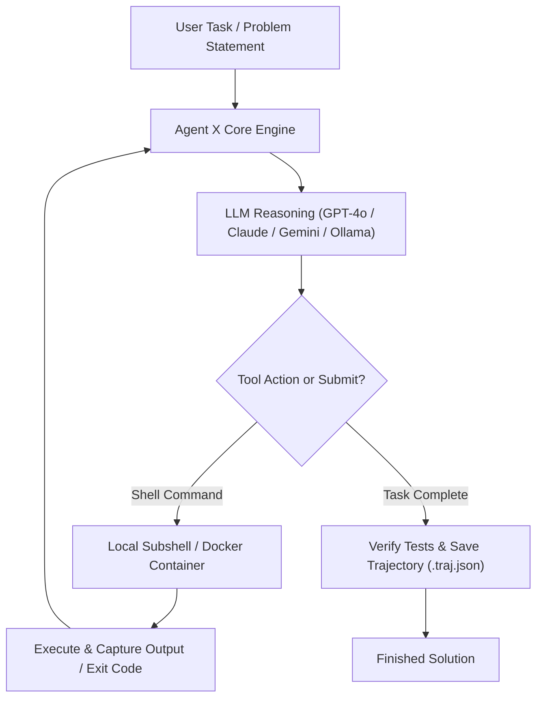

<div align="center">

# 🚀 Agent X | Team Battle Angels
### *An Autonomous, Ultra-Lightweight AI Software Engineering Agent*
**Built for Hackathons & Rapid Codebase Problem Solving**

[](https://www.python.org/)
[](LICENSE.md)
[](run_demo.py)
[](.env.example)

</div>

---

## 💡 What is Agent X?

Developed by **Team Battle Angels**, **Agent X** is a high-performance, autonomous coding agent designed to diagnose, reproduce, edit, and fix real-world software bugs and feature requests.

Most contemporary AI coding agents are heavy monolithic systems with thousands of lines of fragile scaffolding, complex daemon processes, and vendor lock-in. **Agent X** asks: 

> *What if an AI software engineering agent was 100x simpler, started in milliseconds, ran on any computer, and still solved complex programming issues reliably?*

Agent X strips out all unnecessary academic benchmark overhead and presents a streamlined, modular architecture that hackathon judges, developers, and teams can run immediately.

---

## 🏗️ System Architecture & Workflow

Agent X implements an intelligent, deterministic feedback loop where the LLM reasons, executes shell commands in stateless environments, inspects results, and iterates until the task is solved.



---

## ✨ Key Features & Highlights

- ⚡ **Instant Startup & Lightweight**: Boots up in milliseconds with zero heavy daemon processes or background state corruption.
- 🧠 **Multi-LLM Backbone**: Seamless plug-and-play support for **OpenAI (GPT-4o)**, **Anthropic (Claude 3.5 Sonnet)**, **Google Gemini (1.5 Pro)**, **DeepSeek**, and local offline **Ollama** models via LiteLLM.
- 🛡️ **Zero Secret Leaks**: Pre-configured with `.env.example` templates and a comprehensive `.gitignore` preventing any credential, key, or sensitive token leaks.
- 💻 **Cross-Platform Execution**: Built-in support for **Windows**, **macOS**, and **Linux** with automated command normalization, subshell process isolation, and timeout guardrails.
- 🔒 **Safe Sandboxing**: Run directly on your machine or inside isolated **Docker** containers.
- 🎮 **Dual Operation Modes**:
  - **Autonomous YOLO Mode (`--yolo`)**: Complete hands-off automated problem solving.
  - **Interactive Mode**: Human-in-the-loop step-by-step confirmation for safety.
- 📊 **Visual Trajectory Inspector**: Easily review the complete chain of thought, terminal commands, outputs, and diffs using `mini-extra inspect`.

---

## ⚡ 2-Minute Quickstart

### 1. Install Dependencies

```bash
# Install dependencies directly in the project root
pip install -r requirements.txt
pip install -e .
```

### 2. Configure Your API Key

Copy the environment template:
```bash
# Windows
copy .env.example .env

# macOS / Linux
cp .env.example .env
```

Open `.env` and configure your API key:
```env
OPENAI_API_KEY=your_openai_api_key_here
MSWEA_MODEL_NAME=openai/gpt-4o
```
*(You can also set `ANTHROPIC_API_KEY`, `GEMINI_API_KEY`, or use local Ollama with zero keys!)*

### 3. Run Agent X!

```bash
# Solve a specific coding problem autonomously
battle-angels --task "Fix the TypeError when dividing numbers in calculator.py" --yolo

# Run interactively with step-by-step confirmation
battle-angels

# Check CLI options and help
battle-angels --help
```

---

## 🎬 Live Hackathon Demo (Zero Setup Required!)

We built a self-contained demonstration script for hackathon judges and evaluators. If no API key is provided, it automatically runs in **Deterministic Demonstration Mode**, proving the agent's full reproduction, patching, and verification flow:

```bash
python run_demo.py
```

### What this demo shows:
1. Spawns an isolated sandbox with a failing unit test (`ZeroDivisionError`).
2. The agent executes unit tests to reproduce the error.
3. The agent patches the source code with proper error handling.
4. The agent verifies the fix by running the test suite again.
5. The agent issues the completion command and outputs the final submission.

---

## 📂 Simplified Project Structure

```text
Agent X /
├── src/minisweagent/
│   ├── __init__.py           # Team Battle Angels banner, version & core protocols
│   ├── __main__.py           # Entrypoint for python -m minisweagent
│   ├── agents/               # Autonomous & Interactive Agent logic
│   │   ├── default.py        # DefaultAgent core execution loop
│   │   └── interactive.py    # InteractiveAgent (Human-in-the-loop)
│   ├── config/               # Default system & prompt configurations
│   ├── environments/         # Execution environments (Local & Docker)
│   │   ├── local.py          # Cross-platform local shell executor
│   │   └── docker.py         # Containerized isolated environment
│   ├── models/               # Multi-LLM provider interfaces
│   │   ├── litellm_model.py  # LiteLLM (GPT-4o, Claude, Gemini, Ollama)
│   │   └── openrouter_model.py
│   ├── run/
│   │   ├── mini.py           # CLI entrypoint (battle-angels / agent-x)
│   │   ├── hello_world.py    # Minimal programmatic Python example
│   │   └── utilities/        # Trajectory inspector & config manager
│   └── utils/                # Logging & serialization helpers
├── docs/                     # Clean hackathon guides
│   ├── QUICKSTART.md         # 2-minute setup guide
│   ├── ARCHITECTURE.md       # Architecture deep dive
│   └── DEMO_GUIDE.md         # Live demo instructions for judges
├── tests/                    # Robust test suite
├── .env.example              # Secret-free environment template
├── .gitignore                # Comprehensive secret & build file exclusion
├── .pre-commit-config.yaml   # Pre-commit configuration
├── AGENTS.md                 # Battle Angels principles & guidelines
├── LICENSE.md                # MIT License
├── pyproject.toml            # Package configuration & script aliases
├── requirements.txt          # Minimal, essential dependencies
├── run_demo.py               # Live hackathon demo runner
└── README.md                 # Complete presentation documentation
```

---

## 💻 Python API Usage

You can also embed Agent X into your own Python applications:

```python
from minisweagent.agents.default import DefaultAgent
from minisweagent.environments.local import LocalEnvironment
from minisweagent.models import get_model
import yaml
from pathlib import Path

# Initialize model (OpenAI, Claude, Gemini, or Ollama)
model = get_model(input_model_name="openai/gpt-4o")

# Create Agent X instance
agent = DefaultAgent(
    model=model,
    env=LocalEnvironment(),
    system_template="You are Battle Angels Agent X.",
    instance_template="Solve this task: {{task}}",
)

# Run the agent
result = agent.run("Create a FastAPI endpoint that returns server health status")
print(result["submission"])
```

---

## 👥 Team Battle Angels

Developed with ❤️ for the Hackathon by **Team Battle Angels**.

- **Team Name**: Battle Angels
- **Project**: Agent X - Autonomous Software Engineering Agent
- **License**: [MIT License](LICENSE.md)
