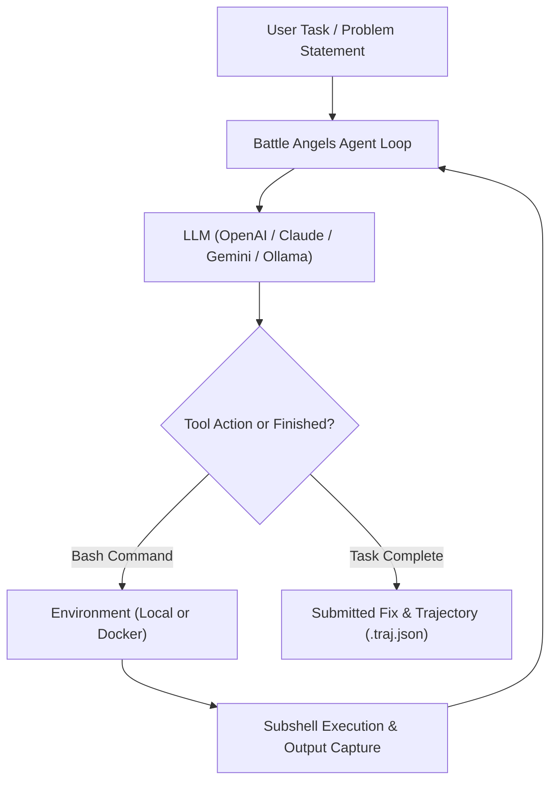

# 🏛️ Architecture & Design - Battle Angels Agent X

**Agent X** is built on a philosophy of **radical simplicity, determinism, and transparency**. Unlike bloated agent frameworks that drown the language model in complex abstractions, custom tool wrappers, and stateful shell daemon sessions, Agent X provides an ultra-lightweight, 100% controllable autonomous loop.

---

## 🔄 Core Execution Loop

---

## 🧱 The 3 Pillars

Agent X is modularized into three core protocols:

### 1. `Model` (LLM Interface)
- **LiteLLM Backbone**: Direct connectivity to 100+ LLM providers (GPT-4o, Claude 3.5 Sonnet, Gemini 1.5 Pro, DeepSeek, Mistral, Ollama).
- **Multi-modal Support**: Processes text, images, and tool calling seamlessly.
- **Linear Conversation History**: Every interaction appends directly to the context window without hidden prompt magic, allowing seamless debugging and fine-tuning.

### 2. `Environment` (Execution Sandbox)
- **`LocalEnvironment`**: High-performance local subshell execution on Windows, macOS, and Linux with automated timeout handling, command chaining, and process tree termination.
- **`DockerEnvironment`**: Isolated containerized runtime for untrusted code execution.
- **Stateless Subshells**: Every action is executed in an independent subshell. This eliminates hanging shell state, corrupted environment variables, and hidden background processes.

### 3. `Agent` (Reasoning & Orchestration)
- **`DefaultAgent`**: Pure autonomous loop with cost limits, wall-time limits, and automated format error recovery.
- **`InteractiveAgent`**: Step-by-step human-in-the-loop mode for reviewing commands before execution.

---

## 🛡️ Safety & Safeguards

- **Budget Guardrails**: Stop immediately if total API cost exceeds `--cost-limit`.
- **Wall-Time Enforcement**: Prevent infinite loops using configurable timeout ceilings.
- **Trajectory Persistence**: Every session is serialized into JSON format with execution timestamps, cost breakdowns, and complete stdout/stderr logs.
